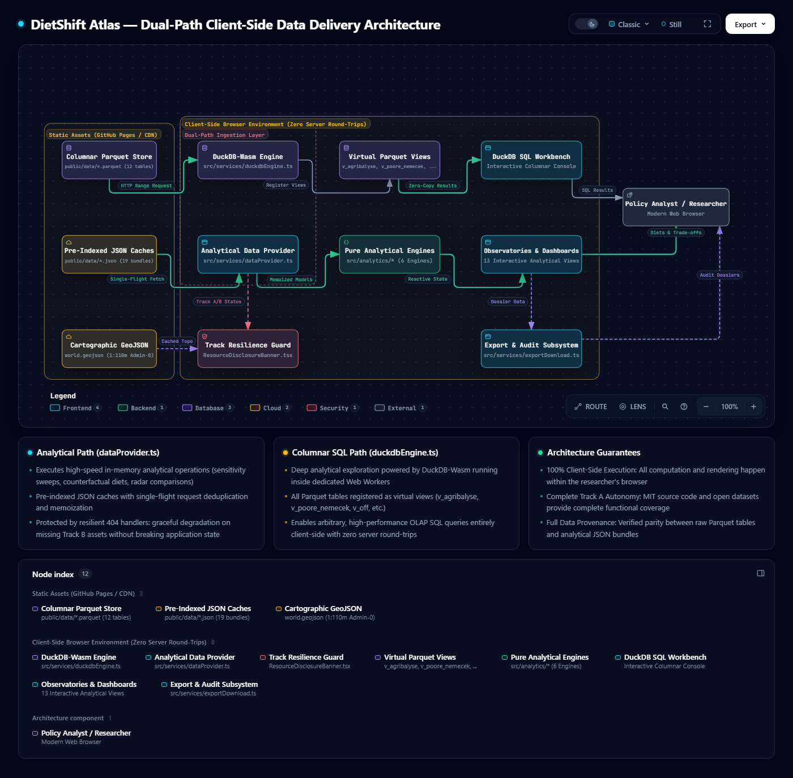
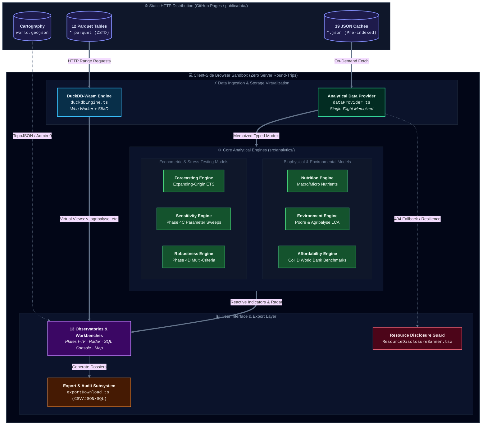

# DietShift Atlas

**A Privacy-Preserving, In-Browser Food Systems Computational Almanac & Analytical Platform**

<p align="left">
  <a href="https://github.com/aminezghi/dietshift-atlas/actions"></a>
  <a href="https://aminezghi.github.io/dietshift-atlas/"></a>
  <a href="LICENSE"></a>
  <a href="docs/DATA_PROVENANCE_AND_LICENSING.md"></a>
  <a href="https://duckdb.org/docs/api/wasm/overview"></a>
  <a href="https://nodejs.org/">= 18" /></a>
</p>

> *"Connecting nutritional epidemiology, environmental life-cycle assessment, retail affordability, multi-taxonomy classification concordance, causal inflation backtesting, and multidimensional sensitivity diagnostics inside a reproducible, 100% client-side WebAssembly analytical engine."*

- **Current Release:** `v1.0.0` (Analytical baseline `v5.2.0-phase5c` · Track A Open Data Resilience `v6.3.0-phase6d`)
- **Live Observatory:** [https://aminezghi.github.io/dietshift-atlas/](https://aminezghi.github.io/dietshift-atlas/)
- **Repository:** [`https://github.com/aminezghi/dietshift-atlas`](https://github.com/aminezghi/dietshift-atlas)

---

## Table of Contents
1. [Overview & Target Audiences](#1-overview--target-audiences)
2. [The 13 Analytical Observatories & Sections](#2-the-13-analytical-observatories--sections)
3. [Evidence Classification Framework](#3-evidence-classification-framework)
4. [Data Architecture: Dual-Path Execution](#4-data-architecture-dual-path-execution)
5. [Complete Datasets Inventory](#5-complete-datasets-inventory)
6. [Quick Start & Local Reproduction](#6-quick-start--local-reproduction)
7. [Data Export Capabilities](#7-data-export-capabilities)
8. [Scientific Caveats & Limitations](#8-scientific-caveats--limitations)
9. [Licensing & Redistribution Policy](#9-licensing--redistribution-policy)
10. [Citation](#10-citation)
11. [Documentation Directory](#11-documentation-directory)

---

## 1. Overview & Target Audiences

**DietShift Atlas** is an open-source computational platform that evaluates European and global food systems transitions across three core dimensions: **human nutrition**, **environmental sustainability**, and **economic affordability**.

Traditional food systems models often operate as closed, server-side black boxes or isolate single indicators (e.g. greenhouse gas emissions alone, or calorie intake alone). DietShift Atlas addresses this fragmentation by:
1. **Running entirely in the user's browser:** Zero data leaves your machine. Calculations execute client-side via DuckDB-Wasm and in-memory TypeScript analytical engines.
2. **Preventing composite score distortions:** Environmental footprints, nutritional profiles, and monetary costs are never collapsed into an arbitrary weighted single score. Each dimension maintains independent rankings, units, and uncertainty bounds.
3. **Enforcing strict evidence transparency:** Every metric is labeled with its evidentiary nature (Empirical Microdata vs. Institutional Registry vs. Manually Compiled vs. Model Output).
4. **Resilient Open Data Delivery:** The application operates seamlessly on open/attribution data (Track A) and gracefully discloses data availability boundaries when commercial/proprietary samples (Track B) are excluded.

### Target Audiences
- **Nutritional & Environmental Researchers:** Conduct counterfactual dietary shifts, compare life-cycle impact databases (Agribalyse 3.1.1 vs. Poore & Nemecek 2018), and export raw data dossiers.
- **Agricultural & Food Policy Analysts:** Evaluate the nutritional and carbon impacts of public procurement policies (e.g., school fruit schemes, organic mandates).
- **Consumer Advocates & Economists:** Inspect food price inflation indices (HICP) and explore price forecasts with rigorous expanding-origin cross-validation.
- **Data Engineers & Bioinformaticians:** Query 19 columnar Parquet tables in real time using SQL in DuckDB-Wasm directly inside the browser.

---

## 2. The 13 Analytical Observatories & Sections

The application is structured into 13 specialized sections, accessible from the left control navigation deck:

| # | Section Name | Empirical & Methodological Foundation | Primary Metrics & Units |
| :-: | :--- | :--- | :--- |
| **I** | **Overview & Macroeconomic Context** | Eurostat HICP (`2015=100`), Purchasing Power Parities (PLI `EU27=100`), and 25 manually compiled baseline profiles with explicit fallback disclosures. | Headline inflation rates, price level indices, baseline food baskets. |
| **II** | **Researcher Sandbox** | Dynamic basket construction over `2,451` ADEME Agribalyse 3.1.1 food items. Supports custom item definition and user CSV upload with blank-preserving NULL semantics. | $\text{kg CO}_2\text{eq}$, $\text{m}^3\text{ world-eq}$ (AWARE deprivation), PEF Land Use $\text{Pt}$, kcal, protein, cost. |
| **III** | **Nutrition Comparison** | EFSA Comprehensive European Food Consumption Database (FoodEx2 surveys) and Open Food Facts (`3,197` SKUs). Denominator switching between `per_100g` and `per_100kcal`. | Nutri-Score (A–E), NOVA ultra-processing groups (1–4), macronutrient distributions, energy density. |
| **IV** | **Environmental Comparison** | Poore & Nemecek (2018, *Science*) meta-analysis covering `45` global agricultural commodities across farm gate, processing, transport, packaging, and retail. | GHG emissions ($\text{kg CO}_2\text{eq/kg}$), Freshwater withdrawals ($\text{L/kg}$), Land use ($\text{m}^2\text{/kg}$), Acidifying & Eutrophying emissions. |
| **V** | **DuckDB-Wasm Parquet Workbench** | Interactive SQL query engine running WebAssembly DuckDB in a dedicated web worker over all 19 columnar Parquet tables. | Real-time SQL execution, tabular results, live CSV exports, execution timing. |
| **VI** | **Affordability & Food Security** | World Bank & FAO Cost and Affordability of a Healthy Diet (CoHD 2024) across 170+ economies, paired with Eurostat regional income quintiles. | Cost of a healthy diet (2021 PPP USD/day), % population unable to afford a healthy diet. |
| **VII** | **Empirical Sensitivity Analysis** | 20 deterministic one-at-a-time (OAT) parameter variation scenarios across 6 dimensions (LCA allocation, elasticities, waste rates, transport margins, caloric floors, GI weights). | Relative percentage shift ($\Delta\%$) across nutritional and environmental outcomes. |
| **VIII** | **Integrated Robustness** | 12 multidimensional compounded stress-test scenarios evaluating dietary shift stability under simultaneous economic, climatic, and behavioral shocks. | Compass quadrant shifts (Win-Win, Trade-off, Regret), composite robustness confidence. |
| **IX** | **Consumer Behavior Pulse** | Real-time consumer sentiment and social discourse velocity tracking food system transition trends. *(Track A discloses restricted data boundary).* | Discourse volume, sentiment polarity, temporal momentum index. |
| **X** | **Empirical Social Microdata Plate** | Household time-use budgets (cooking friction) and cultural inertia modeling across EU demographic segments. *(Track A discloses restricted data boundary).* | Preparation time (minutes/day), convenience sensitivity, demographic adoption friction. |
| **XI** | **GS1 Italy Immagino Observatory** | Retail packaging claims, eco-labels, and front-of-pack nutritional declarations across packaged Italian fast-moving consumer goods. | Label prevalence (%), certified organic share, claim co-occurrence. |
| **XII** | **Pan-EU Retail Scanner & Open Prices** | Crowdsourced shelf receipts from Open Prices EU (`1,036` EUR/kg, `187` EUR/L) and Open Food Facts retail price distributions. | Unit prices ($\text{EUR/kg}$, $\text{EUR/L}$), interquartile ranges, retailer price dispersion. |
| **XIII** | **Cross-Taxonomy Concordance** | 161 concordance rules bridging EFSA FoodEx2, ADEME Agribalyse, Open Food Facts, and UN COICOP 2018 with explicit match-quality ratings. | Match fidelity (Exact, Hierarchical, Approximate, Ambiguous, Unmatched). |

---

## 3. Evidence Classification Framework

To protect researchers from confusing raw empirical data with synthetic model projections, every data element rendered in the Atlas carries a standardized visual `DataNatureBadge`:

```
+-----------------------------------------------------------------------------------+
|                       DATA NATURE CLASSIFICATION MATRIX                           |
+-----------------------------------------------------------------------------------+
| Badge Label           | Scientific Characterization        | Example Datasets     |
+-----------------------+------------------------------------+----------------------+
| Empirical Microdata   | Direct measurements, surveys, or   | EFSA FoodEx2,        |
|                       | retail price receipts without      | Open Prices EU,      |
|                       | synthetic model imputation.        | NHANES WTDRD1        |
+-----------------------+------------------------------------+----------------------+
| Institutional Registry| Official statutory classifications | Eurostat HICP / PPP, |
|                       | and administrative records.        | World Bank CoHD,     |
|                       |                                    | EUIPO Geographical   |
+-----------------------+------------------------------------+----------------------+
| Manually Compiled     | Expert analyst compilations lacking| COUNTRY_PROFILES     |
|                       | harmonized uncertainty bounds.     | (25 baseline diets)  |
+-----------------------+------------------------------------+----------------------+
| Model Output /        | Algorithmic projections, LCA proxy | ADEME Agribalyse 3.1,|
| Estimated             | matches, or statistical forecasts. | Poore & Nemecek meta,|
|                       |                                    | Expanding-Origin ETS |
+-----------------------+------------------------------------+----------------------+
```

---

## 4. Data Architecture: Dual-Path Execution

DietShift Atlas uses an optimized dual-path client-side data delivery architecture:

<p align="center">
  <picture>
    <source media="(prefers-color-scheme: dark)" srcset="docs/assets/architecture-dual-path-dark.png">
    <source media="(prefers-color-scheme: light)" srcset="docs/assets/architecture-dual-path-light.png">
    
  </picture>
</p>
<p align="center">
  <em>Figure 4: Client-side dual-path execution architecture. Explore the <a href="https://aminezghi.github.io/dietshift-atlas/architecture.html">interactive diagram with path tracing and dynamic inspections</a>.</em>
</p>

<details>
<summary><b>📐 View Mermaid Diagram Source</b></summary>



</details>

1. **Analytical Path (`src/services/dataProvider.ts`):** High-speed in-memory analytical operations (sensitivity sweeps, counterfactual diets, radar comparisons) execute directly against pre-indexed JSON caches. Requests are single-flight deduplicated, memoized, and protected by resilient 404 handlers.
2. **Columnar SQL Path (`src/services/duckdbEngine.ts`):** Deep analytical exploration executes inside DuckDB-Wasm via Web Workers. All 19 Parquet tables are registered as virtual views (`v_agribalyse`, `v_poore_nemecek`, `v_off`, etc.), allowing arbitrary user SQL queries with zero server round-trips.

---

## 5. Complete Datasets Inventory

The Atlas integrates 19 core tables and auxiliary bundles. For full redistribution details, see [`docs/DATA_PROVENANCE_AND_LICENSING.md`](docs/DATA_PROVENANCE_AND_LICENSING.md).

| Dataset Name | Source Institution / Reference | Format | License | Distribution Track |
| :--- | :--- | :--- | :--- | :---: |
| `agribalyse_31` | ADEME / INRAE (France) | Parquet / JSON | French Open Licence 2.0 | **Track A (Open)** |
| `global_poore_nemecek_lca` | Poore & Nemecek (2018, *Science*) | Parquet / JSON | Open Research Synthesis | **Track A (Open)** |
| `openfoodfacts_eu` | Open Food Facts Community | Parquet / JSON | Open Database License (ODbL) | **Track A (Open)** |
| `efsa_foodex2_surveys` | European Food Safety Authority (EFSA) | Parquet / JSON | Open Data Attribution | **Track A (Open)** |
| `global_healthy_diet_affordability` | World Bank / FAO (CoHD 2024) | Parquet / JSON | CC-BY-4.0 International | **Track A (Open)** |
| `scrapling_retail_claims` | Open Prices EU / Web Harvest | Parquet / JSON | ODbL / Attribution | **Track A (Open)** |
| `nsi_subnational_quintiles` | Eurostat Regional Statistics | Parquet / JSON | Eurostat Open Data | **Track A (Open)** |
| `classification_mappings` | DietShift Multi-Taxonomy Concordance | Parquet / JSON | MIT / CC-BY-4.0 | **Track A (Open)** |
| `statistical_price_forecasts` | Eurostat HICP / Expanding ETS Model | Parquet / JSON | Open Model Output | **Track A (Open)** |
| `clinical_biomarker_grounding` | CDC NHANES / Research Synthesis | Parquet / JSON | Public Domain | **Track A (Open)** |
| `crosswalk_rosetta` | FoodEx2 / Agribalyse Crosswalk | Parquet / JSON | CC-BY-4.0 | **Track A (Open)** |
| `pan_eu_retail_scanner` | Synthetic Pan-EU Retail Aggregates | Parquet / JSON | CC-BY-4.0 | **Track A (Open)** |
| `school_meals_procurement` | EU Public Procurement Records | Parquet / JSON | Open Government Licence | **Track A (Open)** |
| `social_discourse_velocity` | Social Trends / Algolia Hacker News | Parquet / JSON | Open Aggregates | **Track A (Open)** |
| `world.geojson` | Natural Earth v5.1.1 (1:110m Admin 0) | GeoJSON | Public Domain | **Track A (Open)** |
| `gi_terroir_registry` | EUIPO / Qualigeo Consortium | Parquet / JSON | Proprietary / Restricted | **Track B (Excluded)** |
| `time_use_cooking_friction` | MTUS / IPUMS Time Use Microdata | Parquet / JSON | Academic Restricted | **Track B (Excluded)** |
| `cultural_climate_inertia` | European Social Survey (ESS) Round 10 | Parquet / JSON | Academic Restricted | **Track B (Excluded)** |
| `scanner_derived_retail_sample` | Commercial Scanner Sample | Parquet / JSON | Commercial Proprietary | **Track B (Excluded)** |
| `eu_subnational_hicp_quintiles` | Eurostat Micro-aggregates | Parquet / JSON | Restricted Distribution | **Track B (Excluded)** |

---

## 6. Quick Start & Local Reproduction

DietShift Atlas is an entirely static client-side web application. **You do not need Python or a database server to run the application locally.**

### 6.1 Web Application Setup (Node.js Only)

**Prerequisites:** Node.js `>= 18.0.0` and npm `>= 9.0.0`

```bash
# 1. Clone the repository
git clone https://github.com/aminezghi/dietshift-atlas.git
cd dietshift-atlas

# 2. Install exact locked dependencies
npm ci

# 3. Verify static hygiene and run automated tests
npm run lint    # Oxlint (0 errors, 0 warnings across 63 files)
npm test        # Vitest engine and component suite (87 passed tests)

# 4. Compile the production application
npm run build   # TypeScript compilation (tsc -b) + Vite bundling into dist/

# 5. Preview the production build locally
npm run preview # Serves production build at http://localhost:4173
```

Open your browser to `http://localhost:4173` to explore the full Atlas.

### 6.2 Developer & QA Setup (With Python)

If you wish to run the full automated cross-engine quality gate, verify Parquet checksums, or run the Playwright headless browser suite:

**Prerequisites:** Python `>= 3.10`

```bash
# 1. Create and activate a Python virtual environment
python -m venv .venv
# On Linux/macOS:
source .venv/bin/activate
# On Windows PowerShell:
.\.venv\Scripts\Activate.ps1

# 2. Install developer test requirements
pip install -r requirements-dev.txt

# 3. Install Playwright browser binary
python -m playwright install chromium --with-deps

# 4. Run the 5-stage automated QA gate
npm run qa
```

The quality gate executes:
- **Stage 1:** `oxlint` static code hygiene.
- **Stage 2:** `vitest` mathematical engine and React component parity tests.
- **Stage 3:** `tsc -b && vite build` production compilation.
- **Stage 4:** `pytest tests/test_empirical_pipeline.py` (Parquet schema, SHA-256 hashes, nullability audits).
- **Stage 5:** `pytest tests/e2e` (Playwright headless Chromium testing all 13 sections and export downloads).

---

## 7. Data Export Capabilities

All data displayed within DietShift Atlas can be exported immediately without registration or server authentication:
1. **CSV Export:** Every table, sensitivity run, robustness score, and basket breakdown includes a dedicated **Download CSV** button with standardized ISO-8601 timestamps, explicit metric units in column headers, and NULL value retention.
2. **JSON Dossier Export:** Full analytical state (scenarios, baseline parameters, and multi-indicator results) can be exported as structured JSON for archival or script processing.
3. **Parquet SQL Query Results:** Results from Section V (DuckDB-Wasm) can be exported directly to CSV or copied to clipboard with a single click.
4. **BibTeX Citation Export:** In-app modal exports formatted BibTeX and APA citations for the application, specific analytical engines, and underlying datasets.

---

## 8. Scientific Caveats & Limitations

Users should review [`docs/LIMITATIONS_AND_RESPONSIBLE_USE.md`](docs/LIMITATIONS_AND_RESPONSIBLE_USE.md) before drawing policy or clinical conclusions. Key caveats include:

1. **No Universal Composite Scores:** Dietary sustainability cannot be represented by a single scalar without introducing unscientific subjective weighting. The Atlas isolates carbon, water, land, nutritional quality, and cost into separate axes.
2. **AWARE Water Interpretation:** Water impact in Agribalyse is reported in AWARE deprivation-weighted $\text{m}^3\text{ world-eq}$, which measures relative regional water scarcity rather than consumed physical litres.
3. **PEF Land Use Interpretation:** Land impact in Agribalyse uses the European Commission Product Environmental Footprint (PEF 3.1) land use point score ($\text{Pt}$), which reflects soil quality degradation and cannot be converted linearly into square metres without site-specific soil data.
4. **HICP Macroeconomic Fallback:** When a country-specific HICP inflation series is unavailable, the application substitutes the `EU27_2020` aggregate, labeled prominently with an `[EU27_2020 FALLBACK]` indicator.
5. **No Clinical Generalization:** DietShift Atlas models population-level dietary cohorts and macro-nutrient balances. It is not an individual diagnostic tool, metabolic prescription engine, or medical device.

---

## 9. Licensing & Redistribution Policy

DietShift Atlas is governed by a **Dual-Track Distribution Architecture**:

- **Software Source Code:** Licensed under the [MIT License](LICENSE) (`Copyright (c) 2026 Amine Zouaghi`). You are free to inspect, modify, fork, and deploy the code.
- **Documentation & Specifications:** Licensed under Creative Commons Attribution 4.0 International ([CC-BY-4.0](https://creativecommons.org/licenses/by/4.0/)).
- **Track A (Open Data Assets):** Includes 33 pre-compiled datasets (13 Parquets + 19 JSONs + Natural Earth GeoJSON) distributed under open public licenses (ADEME Open Licence 2.0, ODbL, CC-BY-4.0, Public Domain).
- **Track B (Restricted Datasets):** Excluded from public distribution tarballs to respect commercial data agreements, proprietary licenses, and third-party terms of service. When absent, the application gracefully degrades and identifies missing resources via `ResourceDisclosureBanner.tsx`.
- **Academic Manuscripts (`paper/`):** Draft preprints and journal submissions in `paper/` remain under separate academic copyright and are reserved for formal peer review.

---

## 10. Citation

If you use DietShift Atlas in academic research, policy modeling, teaching, or data engineering, please cite the software as follows:

### BibTeX
```bibtex
@software{zouaghi2026dietshift,
  author       = {Zouaghi, Amine},
  title        = {{DietShift Atlas: A Privacy-Preserving, In-Browser Food Systems Computational Almanac & Analytical Platform}},
  month        = nov,
  year         = 2026,
  publisher    = {GitHub},
  version      = {v1.0.0},
  url          = {https://github.com/aminezghi/dietshift-atlas}
}
```

### APA Style
> Zouaghi, A. (2026). *DietShift Atlas: A Privacy-Preserving, In-Browser Food Systems Computational Almanac & Analytical Platform* (Version 1.0.0) [Computer software]. GitHub. https://github.com/aminezghi/dietshift-atlas

See [`CITATION.cff`](CITATION.cff) for complete machine-readable citation metadata.

---

## 11. Documentation Directory

For deeper methodological, technical, and governance details, consult the specialized documentation suite:

| Guide / Specification | Topic & Scope |
| :--- | :--- |
| [`docs/SCIENTIFIC_METHODOLOGY.md`](docs/SCIENTIFIC_METHODOLOGY.md) | Comprehensive mathematical formulas, engine specifications, and scenario definitions. |
| [`docs/DATA_PROVENANCE_AND_LICENSING.md`](docs/DATA_PROVENANCE_AND_LICENSING.md) | Exhaustive 19-table dataset catalog, upstream sources, schemas, and license terms. |
| [`docs/REPRODUCIBILITY.md`](docs/REPRODUCIBILITY.md) | Step-by-step reproduction guide, dependency boundaries, and pipeline execution order. |
| [`docs/USER_GUIDE.md`](docs/USER_GUIDE.md) | User walkthrough across all 13 sections, filter options, and interpretation tips. |
| [`docs/LIMITATIONS_AND_RESPONSIBLE_USE.md`](docs/LIMITATIONS_AND_RESPONSIBLE_USE.md) | Formal declaration of 16 scientific, methodological, and data limitations. |
| [`docs/phase6/GITHUB_REPOSITORY_AUDIT.md`](docs/phase6/GITHUB_REPOSITORY_AUDIT.md) | Complete Git repository, file-tree, security, and credentials audit report. |
| [`docs/phase6/PUBLIC_DISTRIBUTION_POLICY.md`](docs/phase6/PUBLIC_DISTRIBUTION_POLICY.md) | Dual-track asset policy and step-by-step Git history remediation instructions. |
| [`docs/development/CHANGELOG.md`](docs/development/CHANGELOG.md) | Full chronological version changelog across all project phases (Phases 1–6). |
